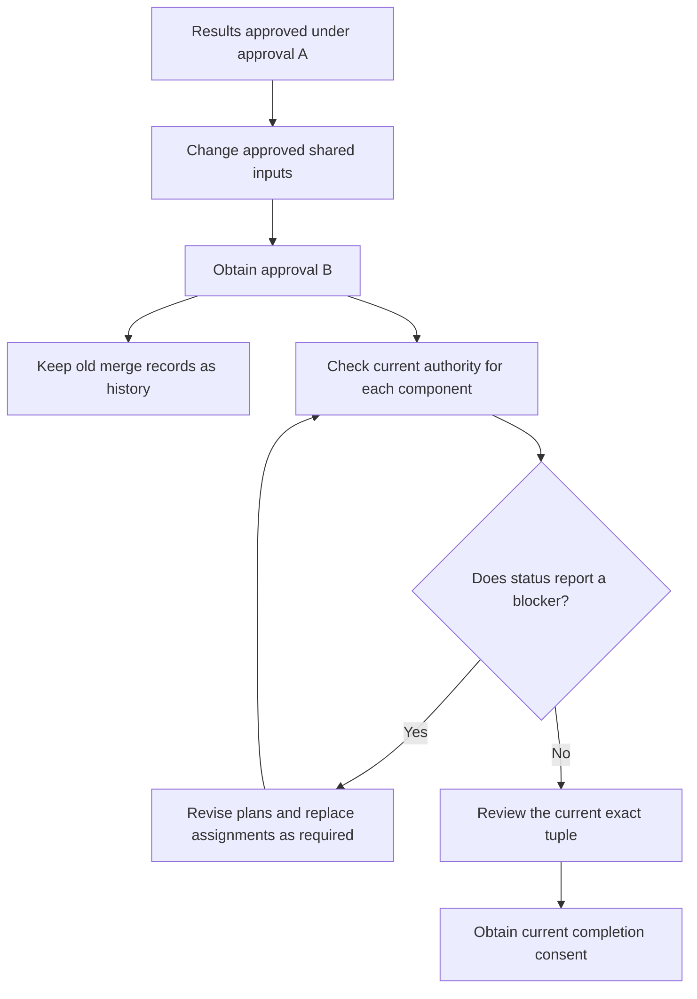
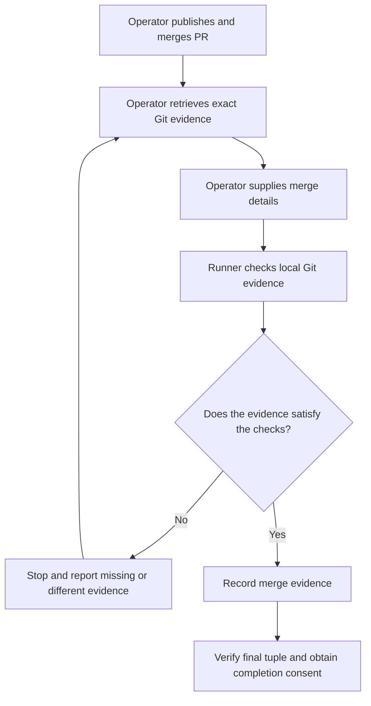

# Documented limits

This document explains current execution and Store-linked coordination limits.
The Store-linked baseline was introduced in commit `3a86abb`; the limits below
were initially checked against source at `9b4865e` on 2026-11-03. Execution
acceptance and Windows recovery notes were updated on 2026-11-04 against
`6e52e98` plus the subsequent recovery correction. Startup notes were then
updated against `0c8fc7f` plus the registration-gated stdin correction.
Shared recovery notes reflect `a826c6b` plus the retirement and nested-archive
changes recorded in [shared recovery verification](SHARED_RECOVERY_VERIFICATION.md).
See the [maintenance priorities](maintenance-priorities.md) for recommended next work.

## Terms

| Term | Meaning |
|---|---|
| Store | The Git repository that contains the shared plan and coordination records. |
| Component | One part of a shared feature, such as API or Web. |
| Assignment | The approved work for one component and one owner. |
| Binding | The local record that connects a change to its imported assignment. |
| Independent clone | A Git clone with its own Git common directory and runner state. |
| Worktree | A checkout that shares a Git common directory with another checkout. |
| Approval | User consent for an exact plan, context, settings, and checks. |
| Tuple | The exact set of component commits used for shared verification. |
| Canonical branch | The approved branch that receives the final archive result. |
| PR | A pull request in a Git hosting service. |

## 1. Store archive location

**Type: Exact approved scope; nested roots supported.**

Store archival supports both `openspec/changes/<shared-change>` at the repository
root and nested layouts such as `planning/team/openspec/changes/<shared-change>`.
The runner selects one unambiguous approved `tasks.md` path from the pinned
contract. The archive preview binds the exact OpenSpec root, post-merge base,
canonical branch and allowed paths. There is no caller-selected root override.

OpenSpec runs from the parent of that exact `openspec` directory in a disposable
checkout. Only its active change, dated archive and canonical specs may change;
sibling trees, redirected paths, unsafe roots and altered archived planning bytes
are rejected. Recovery adopts explicitly inspected scoped output without rerunning
OpenSpec. Prepared results require exact canonical delivery before archive status
becomes `archived`; shared completion remains a separate state.

See [Post-merge archival](team-workflow-reference.md#post-merge-archival).

## 2. Approval renewal applies to the whole feature

**Type: Version 1 authority rule with a conservative scope.**

### Rule

An approval connects user consent to exact shared inputs.
These inputs include the contract, component plans, settings, and required checks.

A new approval starts a new feature-wide approval period.
The implementation calls this period an approval epoch.
Results from the old approval do not automatically become current milestones under the new approval.
This rule also applies when some component code did not change.

### Example

1. Accept and merge API and Web under approval A.
2. Change shared guidance.
3. Obtain approval B for the new shared inputs.
4. Inspect the current status of API and Web.

The runner keeps the old merge records.
It can mark an old result as `requiresReapproval`.
That result cannot authorize a new dependent assignment or current completion.

### Effect

The runner does not remove commits or undo merges.
The old records remain available as history.
Their existence does not prove compliance with the new approval.

Old combined reviews, final reviews, and completion consent do not automatically carry forward.
Version 1 has no automatic procedure to transfer unchanged component authority to a new approval.
This rule can require additional planning and coordination work.

### Procedure

1. Inspect every component blocker with `coordination status --json` and the required feature, Store, and map arguments.
2. Check the current shared inputs and component plans.
3. Resolve the reported plan and assignment conflicts.
4. Use a revised component plan and renewed approval for further work on a merged component.
5. Revoke and replace stale assignments when required.
6. Review the current exact tuple.
7. Obtain new completion consent when required.

Do not assume that every component must repeat all work.
Use the reported blockers to determine the required actions.

See [Changes, failures, and recovery](team-workflow.md#changes-failures-and-recovery).

## 3. Replacement assignments require explicit retirement

**Type: Supported local recovery with retained evidence.**

A coordinator revocation does not replace a local binding. Use `component retire`
to preview and confirm retirement of the old assignment, identifying its exact
change, assignment, owner and reason. This local operation requires a confirmation
token, not a coordination expected-head SHA. It does not revoke shared authority
or grant approval to a replacement.

Retirement refuses incomplete imports, active or uncertain workers/terminals,
pending integration, cleanup, and archival. Recover these first or use a fresh
independent clone. A worktree shares its Git common directory and binding.

Before changing active state, retirement saves the exact binding, feature and
runner bytes under `component-retirements/<feature>/<assignment>.json` in the
runner state directory. It removes only matching active feature/runner state and
leaves a retired binding. Context, worktrees, branches, reports, logs and exported
submissions remain in place. Retrying the same confirmation resumes partial
retirement; changed bytes or identity stop recovery. Keep the journal: it is
retained evidence and prevents importing the retired assignment again.

Retrieve and check out the replacement's exact approved base and committed plan,
then use normal inspect/import with a different approved assignment. Its resources
and execution state are fresh. Late commands for old attempt IDs cannot mutate
the replacement. Retirement does not clean up old resources or renew approval.
On Windows, retirement also retains the protection journal and NTFS rules.

See [Changes, failures, and recovery](team-workflow-reference.md#changes-failures-and-recovery).

## 4. Initial worker prompts wait for registration

**Type: Corrected startup ordering with bounded lock contention.**

Codex and Claude initial workers receive their task prompts on stdin only after
successful synchronous PID registration and repository lock release. Failed
registration destroys stdin without delivering the prompt. Permission preflight,
session identity, successful exit checks, and explicit retries remain required.
Interactive resume is unchanged.

The old Codex argument-prompt startup ordering is superseded by the
[startup readiness verification](WORKER_STARTUP_VERIFICATION.md). Its native
fast-child tests replace reliance on the feature fixture's saved-PID/lock polling.

The lock implementation still retries for up to three seconds when another live
local process owns it. Long contention, unreadable metadata, or unverifiable
ownership can fail. Do not remove the repository lock to force progress; inspect
status and logs before recovery. This correction does not claim to eliminate all
contention during later reporting or coordination.

## 5. Operators control Git synchronization and PR publication

**Type: Intentional design boundary.**

### Rule

The runner checks locally available Git evidence.
The operator states that the PR merged and supplies its URL and exact delivery commit.
The runner does not query a hosting service for live PR status.
A PR URL alone is insufficient merge evidence.

The runner does not automatically clone, fetch, pull, push, or publish branches.
Operators perform these actions through their normal Git workflow.

### Checks

The runner checks delivery commit reachability on the declared, locally available delivery branch.
For a normal merge, it also checks accepted commit ancestry.
For squash or rebase delivery, the operator must specify the actual merge style.
The runner compares the accepted changed-path content with the delivery commit.

A content difference requires fresh delivered-snapshot review and independent acceptance.
Changes outside the accepted paths can remain different.
Final verification uses the recorded merged tuple.

### Effect

Local status describes the retrieved Git state.
It does not prove the current state of the hosting service.
Missing or old local history can prevent the runner from finding required evidence.

### Procedure

1. Publish and merge the PR through the authorized Git workflow.
2. Retrieve the exact delivery commit and update the declared local delivery branch.
3. Inspect local differences before branch updates.
4. Supply the actual merge style, PR URL, and operator statement.
5. Preview and record the verified merge evidence.
6. Run current final verification and obtain completion consent.

If a coordination push is rejected, inspect remote history and resolve the conflict.
Do not force-push coordination history as a recovery shortcut.
A preview token does not authorize publication.

See [Team lifecycle and archival](team-workflow.md#complete-team-walkthrough).

## 6. Copilot CLI startup correction and acceptance scope

**Type: Known compatibility gap.**

The original CLI adapter reserved a session UUID and sent the prompt through
stdin. The recorded authenticated Windows run instead needed
`--trust-folder -p PROMPT` without `--session-id`.

The production adapter now uses that new prompt-mode launch and binds the actual
root session through the nonce lease. Capability checks require prompt-mode and
folder-trust support. Saved-session attachment uses `--resume` with the observed
session ID. Previously reserved attempts require inspection and an explicit
fresh retry; their identities are not rewritten.

Regression coverage preserves report-before-stop ordering, process exit, root
ownership, and legacy-attempt diagnostics. Real implementation/integration,
repair, fresh review, cancellation, and interrupted-supervisor recovery are now
recorded in the [expanded acceptance results](LIVE_ACCEPTANCE_2026-11-04.md).

A lost Windows Copilot supervisor is still unsuccessful execution. Recovery can
acknowledge its stale launcher only after a matching root stop and proof that
both saved process trees are gone. The task/job stays failed with null exit
evidence and no invented success receipt. Unknown or live identities remain
blocked. This does not establish interactive resume, credential-failure behavior,
every harness/backend combination, or final approval/archival.

## 7. Delegated execution has narrower support than local workers

**Type: Current platform and shared-record contract limits.**

Native Windows local tasks and managed features support all four harness
adapters. Windows delegated import requires a local NTFS checkout, PowerShell 7.2
or newer, a token without backup or restore privileges, and verified protection
of the pinned context. Confirmed import needs an idle
runner runtime. If protection cannot be proved or a sealed context changes,
the runner blocks execution. See the [Windows delegation guide](windows-delegation-guide.md)
for the trust boundary and recovery steps.

The version-1 shared coordination record validator accepts only `codex` and
`claude` harness settings. Copilot local worker support therefore does not imply
Store-linked Copilot assignment support, even on a non-Windows host. Extending
that contract needs compatibility tests for existing records, import, review,
repair, and exported receipts.

## Verification scope

The original Store-linked acceptance recorded 204 passing tests and a package
dry run. This is historical evidence, not a current suite count. Later
platform and harness verification is recorded in the [Windows verification
guide](WINDOWS_PORTABILITY_VERIFICATION.md) and [real harness acceptance
record](REAL_WINDOWS_HARNESS_ACCEPTANCE.md). Neither simulated tests nor the
narrow live runs extend support to excluded configurations or prove that all
startup interleavings have been tested.
